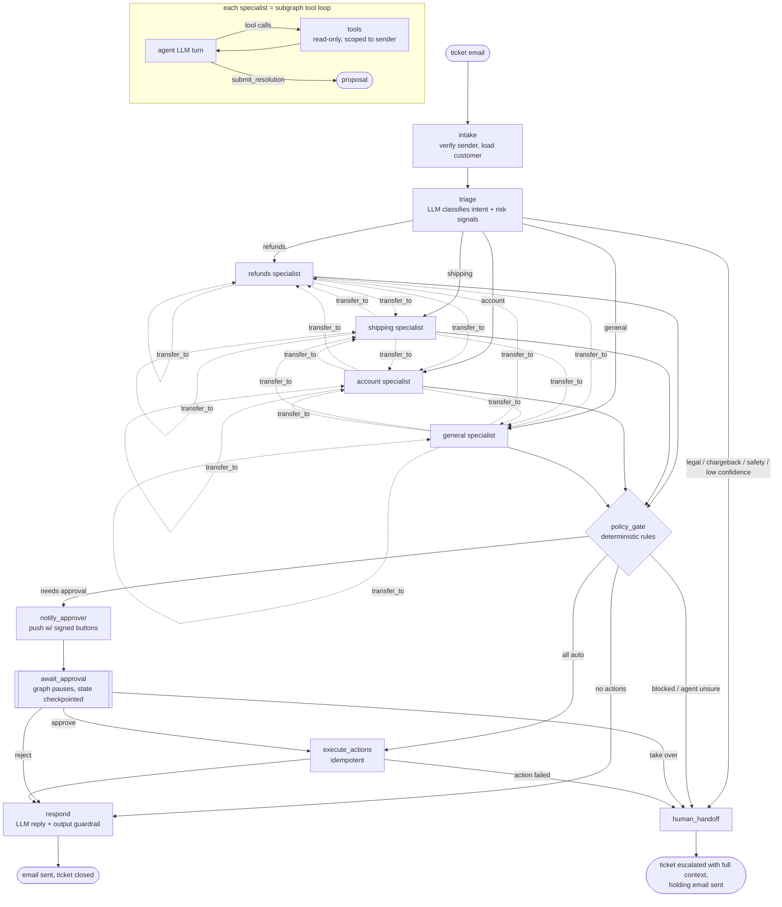

# Autonomous Support Resolution Agent

An AI workflow that **resolves** e-commerce support tickets instead of just replying to them. A customer writes *"my order arrived damaged, I want a refund"*. The system works out what they want, looks up the order, checks refund policy, issues the refund (or a replacement), writes the reply and closes the ticket. Anything risky goes to a human first, as a push notification with Approve / Reject buttons.

Built with **LangGraph** (orchestration, shared state, checkpointing, human-in-the-loop) and a **provider-agnostic LLM gateway** (Claude by default) that handles rate limits, outages and model fallback.

```
$ support run --from james.oconnor@example.com -s "Headphones cracked" "The NC700 headphones (A2001) arrived cracked. Refund please."

  triage              intent=refunds (0.97) -> refunds_specialist
  refunds_specialist  tool get_order / tool check_refund_eligibility
  refunds_specialist  submitted resolution: resolve
  policy_gate         approval: refund $249.00 is above the auto-approve limit
  notify_approver     approval requested: Approve refund $249.00 for A2001?     <- push notification to phone
  ...                 (reviewer taps Approve)
  execute_actions     1/1 actions succeeded                                     <- idempotent refund
  respond             reply sent (llm), status=resolved
```

---

## Architecture



Every node also has a **retry policy** (transient infrastructure errors) and a graph-level **error handler**. Any node that still fails sends the case to `human_handoff` with the error attached, so a case never crashes silently or leaves the customer without a reply.

`support graph` prints the compiled graph as Mermaid.

## Design decisions

**1. The LLM proposes, code decides.** Specialists can only *read* (order lookup, tracking, eligibility, help center). To change anything they call `submit_resolution` with proposed actions. A deterministic policy engine then marks each action `auto`, `approval` or `deny`, and a separate executor carries it out. Refund limits, return windows, fraud flags, per-customer budgets and ownership checks are Python code, not prompt text. The model never sees the thresholds, so it can't learn to stay just under them. A prompt-injected agent can at most *propose* something, and the gate stops it.

**2. Router + specialists with least privilege.** Triage is a structured-output classification, and routing on top of it is deterministic code. Each specialist gets only the tools and action types for its job. This is enforced in the tool **schema**, not just the prompt: the generalist's `submit_resolution` literally has no `actions` field. Specialists can hand a case to each other (`transfer_to`, capped at 1 hop).

**3. One shared state, checkpointed.** `CaseState` carries the ticket, customer, triage, proposal, policy verdicts, approval, executed actions, errors, LLM telemetry and an append-only audit timeline. LangGraph checkpoints it to SQLite after every step (`durability="sync"`). A case paused for approval on Monday resumes on Tuesday, in a different process, with full context. Specialist tool loops are subgraphs, so every LLM turn is a checkpoint too.

**4. Recovery at every level.**

| Failure | What happens |
|---|---|
| 429 rate limit | Honour `retry-after` if it's short. If the provider asks for a long wait, fall back to the next model immediately instead of stalling |
| 5xx / overloaded / timeout | Jittered exponential backoff on the same model, then the next model in the chain |
| Model unavailable / bad request / truncated / malformed JSON | No pointless retries: go straight to the next model |
| A model keeps failing | Per-model **circuit breaker** opens, and later calls skip it until a half-open probe succeeds |
| Policy refusal | Claude's server-side `fallbacks: "default"` retries on Anthropic's recommended model. If it still declines, a human takes the case, never another model |
| All models down | `AllModelsFailedError`, then the graph error handler sends the case to a human with the attempt log, and the customer gets a holding email |
| Reply model down, or the reply fails the guardrail | A deterministic template reply, because the refund already happened and the customer must hear about it |
| Carrier API down | Retried inside the tool; if it's still down, the agent gets a structured error and adapts |
| Payment API times out *after* the refund committed | Retried with the **same idempotency key**; the provider returns the original refund, so nothing is refunded twice |
| Process crashes mid-execution | The action ledger shows `in_progress`; on resume the same key replays the recorded result |
| Agent loops or never decides | Turn budget, then a human |

**5. Exactly-once side effects.** There are two layers. (a) An **action ledger** keyed by `hash(case, action)` means a node that re-runs (retry, resume, crash) never repeats a completed action. (b) The **provider idempotency key** means a retried refund after a lost response is deduplicated by the payment provider itself. Stripe test mode uses Stripe's native `Idempotency-Key`; the mock provider has the same semantics.

**6. Untrusted input is data.** Ticket text is wrapped and labelled untrusted in every prompt. Lookups are scoped to the verified sender, so someone else's order returns "not found", exactly like a missing one. Triage flags injection attempts, and the policy engine then requires approval for any money movement. Push-notification buttons carry an HMAC over `(case, decision, nonce)`, so a stranger who guesses the topic can't approve refunds. Approvals are applied with an atomic `pending -> decided` transition, so a double tap executes once.

**7. Provider-agnostic LLM layer.** Nodes speak a neutral `LLMRequest`/`LLMResponse`. The Claude adapter (`llm/anthropic_provider.py`) handles strict tools, structured output, effort, prompt caching and verbatim replay of thinking blocks. Adding OpenAI or Gemini means one adapter class plus one line in `llm/registry.py`, and the model chain is set in `config/llm.yaml`.

## Quickstart

```bash
py -3 -m venv .venv && .venv\Scripts\activate        # macOS/Linux: python3 -m venv .venv && source .venv/bin/activate
pip install -e ".[dev]"                               # add ,stripe for Stripe test mode
copy .env.example .env                                # then set ANTHROPIC_API_KEY
support init-db                                       # seeds a mock shop: customers, orders, payments, shipments

support run --from maria.gomez@example.com -s "Broken coffee set" "My pour-over set from order A1001 arrived shattered. Refund please."
support run --from james.oconnor@example.com -s "Headphones" "The headphones from A2001 arrived cracked, refund please."
support approvals list
support approvals decide <case-id> approve            # or: reject --note "..." | takeover
support case <case-id>                                # full state + audit timeline
```

Scenario customers to try are defined in `src/support_agent/backend/seed.py`: a damaged item, an over-limit refund, a lost package, an order still processing (cancel or change address), a duplicate charge, a fraud-flagged account, a 3-day-old account, an already-refunded order, and more.

### Push-notification approvals (ntfy)

1. Install the **ntfy** app (Android/iOS) and subscribe to a long random topic name.
2. In `.env`, set `NTFY_TOPIC` (the topic you subscribed to), `NTFY_REPLY_TOPIC` (another random name) and `APPROVAL_SIGNING_SECRET`.
3. Run `support approvals listen` in a terminal. When a case needs approval your phone buzzes; tap **Approve**, **Reject** or **Take over** and the workflow resumes. No web server is needed: the buttons post signed messages to the reply topic that the listener watches.

### Stripe test mode (optional)

Set `STRIPE_API_KEY=sk_test_...`, run `support seed-stripe` (creates a test PaymentIntent for each seeded payment), then set `PAYMENTS_BACKEND=stripe`. Refunds now go through the real Stripe API with fake money. Live keys are refused.

## Evaluation

`src/support_agent/evals/dataset.py` has **60 labelled tickets** covering damaged/wrong/defective items, over-limit refunds, return-window exceptions, final-sale items, lost packages, cancellations, address changes, duplicate charges, password resets, email changes, FAQs, legal/chargeback/safety/press escalations, prompt injection, cross-account requests, unknown senders and ambiguous requests. Each label lists acceptable routes, outcomes and action sets, plus actions that must **never** run without a human.

```bash
support eval                        # normal conditions
support eval --chaos flaky          # 15% 429s + 10% 5xx + 5% timeouts on every model, flaky carrier, payment timeouts before/after commit
support eval --chaos primary-outage # primary model hard down -> fallback chain + circuit breaker
support eval --chaos total-outage   # every model down -> every case must still end in a clean human hand-off
support eval --limit 10             # quick smoke run
```

Each run writes `evals/results/<timestamp>-<chaos>.md` and `.json` with:

- **completion rate**: cases that reached a safe end state (resolved, asked for info, awaiting approval, escalated)
- **auto-resolution rate** and **correct auto-resolution rate**
- **escalation recall and precision**: did cases that needed a human get one, and vice versa
- **wrong actions executed without approval** and **double refunds** (target: 0)
- routing / outcome / action accuracy, LLM calls per ticket, fallback-served calls, retries, cost, p50/p95 latency

Each eval run calls the real model API (roughly 5 LLM calls per ticket, and the report prints the actual cost). For cheaper runs, put `sonnet` first in the chains in `config/llm.yaml`.

### Results

| Condition | Completion | Auto-resolved (correct) | Escalation recall | Wrong actions | Double refunds |
|---|---|---|---|---|---|
| normal | _run `support eval`_ | | | | |
| flaky APIs | _run `support eval --chaos flaky`_ | | | | |
| primary model down | _run `support eval --chaos primary-outage`_ | | | | |
| all models down | _run `support eval --chaos total-outage`_ | | | | |

## Tests

```bash
pytest -q     # 64 tests, no API key or network needed (scripted LLM)
```

They cover the happy path, approve/reject/takeover, prompt injection against another customer's order, a full LLM outage, the primary model down with the circuit breaker, reply-model degradation, a hallucinated-refund guardrail, specialist transfer, a payment timeout after commit, a carrier outage, the turn budget, crash-then-replay idempotency, forged/stale/double-tapped approvals, every policy rule, gateway retry/fallback/breaker behaviour, Claude request shapes and error mapping.

## Layout

```
config/llm.yaml             model chains per route, retry + circuit breaker settings
config/policy.yaml          business rules (limits, windows, risk flags) - not in prompts
src/support_agent/
  graph/                    CaseState, nodes, graph assembly (LangGraph)
  agents/                   specialist subgraphs, read-only tools, prompts
  llm/                      neutral contract, gateway (retry/fallback/breaker), Claude adapter, registry
  policy.py                 deterministic policy engine
  executor.py               exactly-once action execution (ledger + provider idempotency)
  approvals.py              human decisions -> resumed workflows (CLI + ntfy listener)
  chaos.py                  fault injection for resilience testing
  backend/                  mock company systems: SQLite shop, payments (mock/Stripe), carrier, notifier, help center
  evals/                    labelled dataset, runner, scoring
tests/                      scripted-LLM tests for every path above
```
